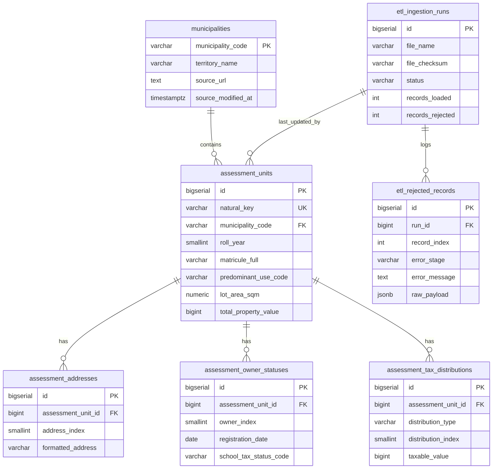

# 2. Architecture de la base de données

## 2.1 Choix du SGBD : PostgreSQL 16
Pour exploiter des données foncières destinées à alimenter un CRM et des workflows IA, **PostgreSQL** s'impose pour plusieurs raisons :
- **Intégrité relationnelle stricte** : gestion native des clés étrangères et des relations `1:N` (adresses, statuts, répartitions fiscales).
- **Idempotence native** : support performant de l'instruction `INSERT ... ON CONFLICT DO UPDATE` (*UPSERT*), indispensable pour réexécuter le pipeline sans créer de doublons.
- **Types riches et JSONB** : stockage exact des montants et superficies (`BIGINT`, `NUMERIC`) et conservation des charges brutes rejetées (`JSONB`) dans la table de quarantaine `etl_rejected_records`.
- **Extensibilité géographique (PostGIS)** : possibilité d'ajouter des colonnes géométriques et un index spatial `GIST` pour enrichir les unités avec les données FGDB/GeoPackage.

---

## 2.2 Modèle conceptuel et relationnel

---

## 2.3 Justification des choix de modélisation (7 tables)

1. **`municipalities` (référentiel municipal)** : sépare les métadonnées issues du CSV d'index (`territory_name`, `source_url`, `source_modified_at`) afin d'éviter la redondance sur des milliers d'unités d'évaluation.
2. **`assessment_units` (table centrale des propriétés)** : regroupe les attributs `1:1` d'une unité (matricule segmenté, caractéristiques physiques `RL03xx`, valeurs au rôle `RL04xx`, classification fiscale principale `RL05xx`).
   - **Clé naturelle unique (`natural_key`)** : construite à partir de `municipality_code + roll_year + matricule_full`, elle permet un `UPSERT` déterministe lors des réexécutions.
   - **Matricule en `VARCHAR`** : préserve impérativement les zéros initiaux (ex. `01042`) qui seraient perdus en type numérique.
   - **Montants en `BIGINT`** : évite toute imprécision liée aux flottants (`FLOAT`).
3. **Tables satellites `1:N` (`assessment_addresses`, `assessment_owner_statuses`, `assessment_tax_distributions`)** : une même unité d'évaluation peut posséder plusieurs adresses civiques (immeuble multi-logements ou coin de rue), plusieurs statuts de propriétaires et plusieurs lignes de répartition fiscale. Les isoler en tables dédiées avec contrainte `UNIQUE (assessment_unit_id, ..._index)` + `ON DELETE CASCADE` évite des colonnes répétitives (`address_1`, `address_2`...) et facilite le requêtage CRM.
4. **Traçabilité et observabilité (`etl_ingestion_runs` & `etl_rejected_records`)** : chaque exécution est tracée avec le checksum SHA-256 du fichier et ses compteurs (`read`, `loaded`, `rejected`), tandis que chaque enregistrement invalide est isolé avec son étape d'échec (`parse`, `validate`, `transform`, `load`) et sa charge JSON brute pour rejeu ou diagnostic.

---

## 2.4 Stratégie d'indexation (CRM & Analytics)

Des index ciblés (`sql/001_init_schema.sql`) accélèrent les cas d'usage fréquents d'un CRM immobilier ou d'un agent IA :
- `idx_units_municipality_year` : filtrage rapide par territoire et millésime du rôle.
- `idx_units_matricule` : recherche directe par numéro de matricule.
- `idx_units_cubf` : segmentation par usage prédominant (résidentiel, commercial, agricole, terrain vacant).
- `idx_units_total_value` : requêtes par fourchette de valeur foncière.
- `idx_addresses_formatted` : recherche par adresse civique normalisée.

---

## 2.5 Ouverture géographique (Bonus)

Les fichiers XML du rôle ne contiennent pas de géométries. Le schéma anticipe toutefois cet enrichissement via les colonnes `latitude` et `longitude` sur `assessment_units`. Dans une phase ultérieure, une jointure par matricule avec les fichiers vectoriels publiés par le MAMH (FGDB / GeoPackage) et l'activation de l'extension **PostGIS** permettraient des requêtes spatiales (proximité, polygones de quartier, cartes interactives).